<p align="center">
  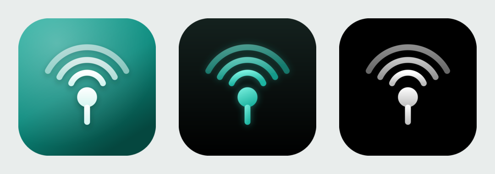
</p>

<h1 align="center">Hotspot Proxy</h1>

<p align="center">
  An iOS app that lets devices on your iPhone's Personal Hotspot use <b>the iPhone's own cellular connection as a proxy</b>.<br>
  HTTP, HTTPS (CONNECT), and SOCKS5 (TCP + UDP ASSOCIATE) on a single port.
</p>

<p align="center">
  
  
  
</p>

---

## Why

Some carriers and plans classify tethered hotspot traffic separately and throttle or cap it. Hotspot Proxy runs a proxy server inside the iPhone. When devices on the hotspot (Mac, iPad, laptop) go through it, their traffic leaves as the iPhone app's own traffic.

## Screenshots

| Main (running) | Hotspot off | Settings | Welcome |
|---|---|---|---|
| 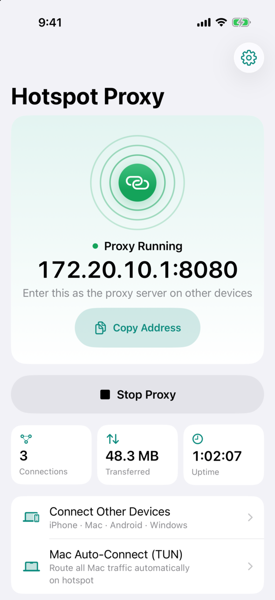 | 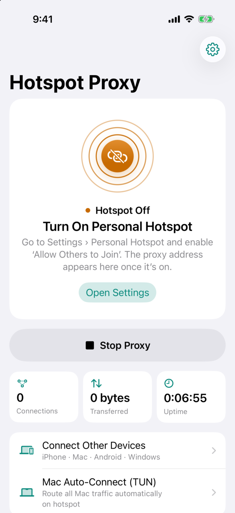 | 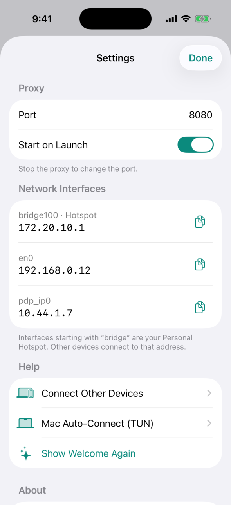 | 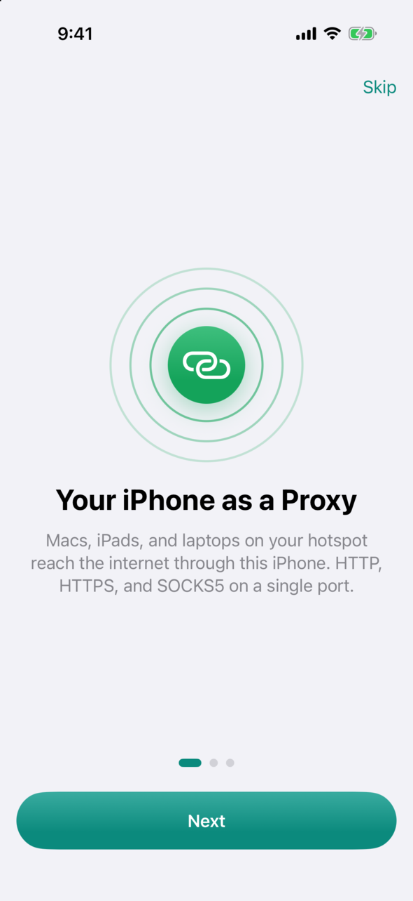 |
| 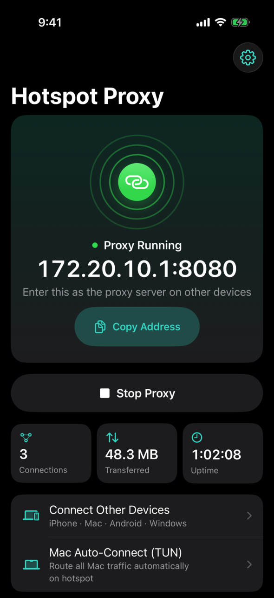 | 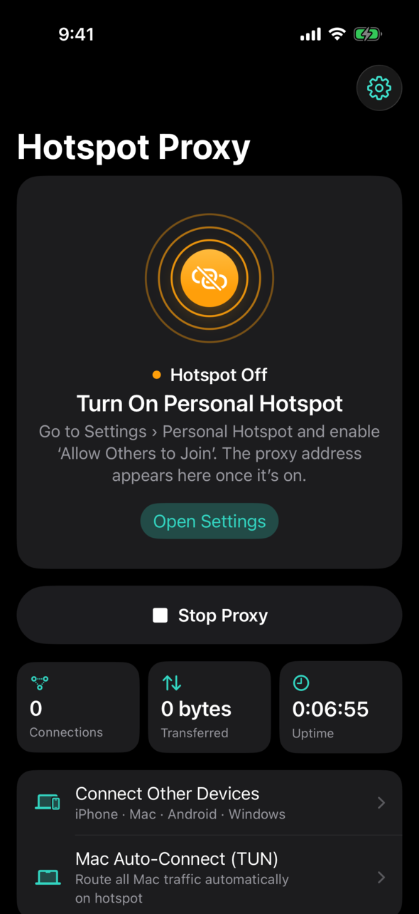 | 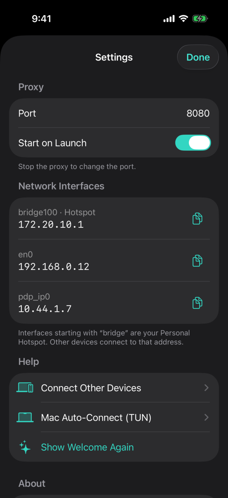 | 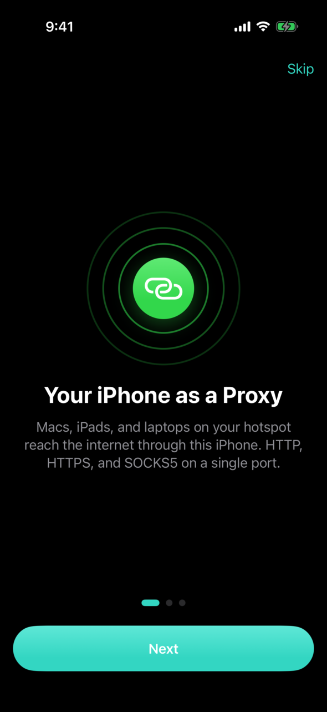 |

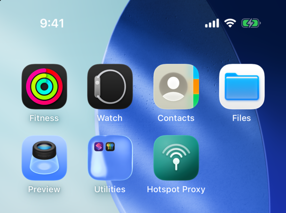

### Lock Screen and Home Screen widgets

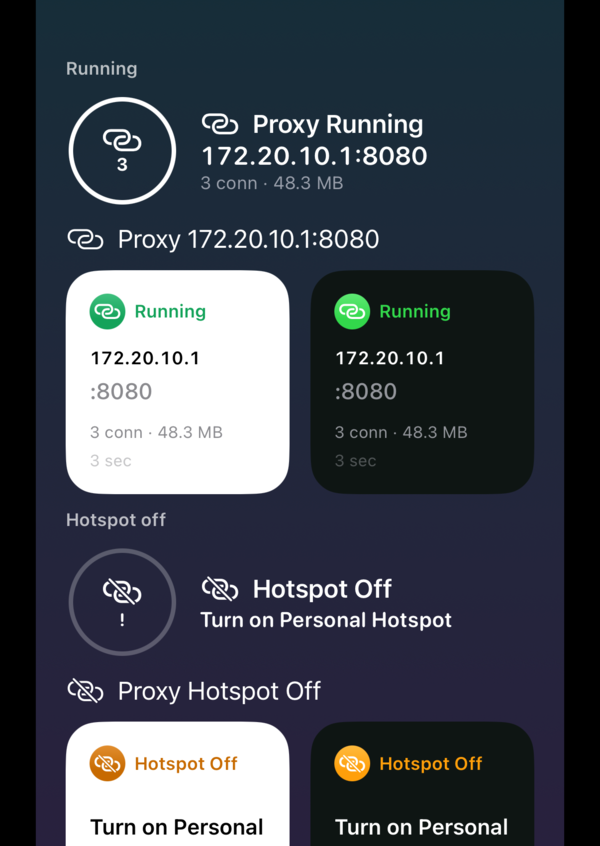

- **Lock Screen** has three widgets:
  - Circular shows the status and connection count.
  - Rectangular shows the status, `IP:port`, connections, and data transferred.
  - Inline shows a one-line status.
- **Home Screen** has a small widget with a status chip, the proxy address, stats, and when it last updated.
- Tapping a widget opens the app. The app reloads widgets only when the state changes, so they cost almost no battery.

## Features

- **Status hero.** A "signal ring" shows the current state: green while running, amber when the hotspot is off, grey when stopped, and red on error.
- **One-tap start and stop**, with haptic feedback.
- **Copy the address.** One tap copies `172.20.10.1:8080` to enter on other devices.
- **Live stats** for active connections, data transferred, and uptime. Stats update only while the screen is visible.
- **Connection guides** for iPhone/iPad, macOS, Android, and Windows.
- **Mac auto-TUN guide.** The `mac/` scripts route all system traffic through the proxy automatically.
- **Welcome flow** that covers turning on the hotspot, local network permission, and how background keep-alive works.
- **Accessibility:** Dark Mode, Dynamic Type (including accessibility sizes), VoiceOver labels, and Reduce Motion.

## Usage

1. On the iPhone, turn on **Settings › Personal Hotspot › Allow Others to Join**.
2. Open the app and tap **Start Proxy**. By default it starts automatically on launch.
3. Join the hotspot from another device and set its proxy manually:
   - Server: `172.20.10.1` (shown in the app)
   - Port: `8080`
   - HTTP, HTTPS, and SOCKS5 all use the same port.

### Mac: system-wide automatic proxy (optional)

The `mac/` directory has a launchd setup built on [sing-box](https://sing-box.sagernet.org) TUN. It sends all traffic through the iPhone proxy, but **only while the Mac is on the hotspot**.

```bash
brew install sing-box
sudo bash mac/install.sh             # install (auto on/off on network changes)
sudo bash mac/uninstall.sh           # remove
sudo bash mac/install-tailscale.sh   # (optional) run Tailscale as a CLI daemon
```

`hotspot-tun.sh` runs on every network change and every 30 seconds. When the Mac is on the iPhone hotspot (`172.20.10.x`) and `172.20.10.1:8080` responds, it turns the TUN and DNS on. Otherwise it restores the normal setup.

## Background behavior and battery

iOS doesn't keep a background app's sockets alive for long. To stay running, the app loops **silent audio** (8 kHz, in 30-second segments). The audio mixes with other apps (`mixWithOthers`) at zero volume. UI timers run only while the screen is visible, and idle UDP flows are cleaned up after 60 seconds.

> The silent-audio background mode may not pass App Store review. This app is intended for personal sideloading or developer-signed builds.

## Build

```bash
brew install xcodegen
xcodegen generate
open HotspotProxy.xcodeproj
```

- The project has two targets: `HotspotProxy` (the app) and `HotspotProxyWidget` (the WidgetKit extension).
- The targets share state through the App Group `group.com.indoyoon.hotspotproxy`. To build under your own team, change `DEVELOPMENT_TEAM`, the bundle IDs, and the App Group in `project.yml`.
- Icon sources are in `design/icon/*.svg`. The design system is in [`DESIGN.md`](DESIGN.md).

## Layout

```
Sources/
  App.swift              App entry, deep-link handling
  Model/ProxyModel.swift Proxy state, widget snapshot publishing
  Views/                 Main, settings, welcome, connection guide, Mac guide
  Design/                Tokens and shared components (SignalRing, StatusHero, ...)
  ProxyServer.swift      HTTP/CONNECT + SOCKS5 server (Network.framework)
  UdpRelay.swift         SOCKS5 UDP ASSOCIATE relay
  KeepAlive.swift        Silent-audio background keep-alive
Widget/                  Lock Screen and Home Screen widgets
Shared/                  App/widget shared snapshot, deep links, color assets
mac/                     macOS sing-box TUN automation scripts
```

## Deep links

| URL | Action |
|---|---|
| `hotspotproxy://open` | Open the app |
| `hotspotproxy://start` / `stop` / `toggle` | Control the proxy |
| `hotspotproxy://copy` | Copy the proxy address |

Use the "Open URLs" action in Shortcuts to automate them.
